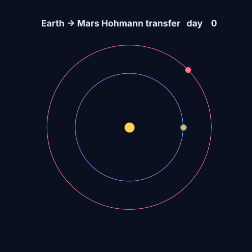
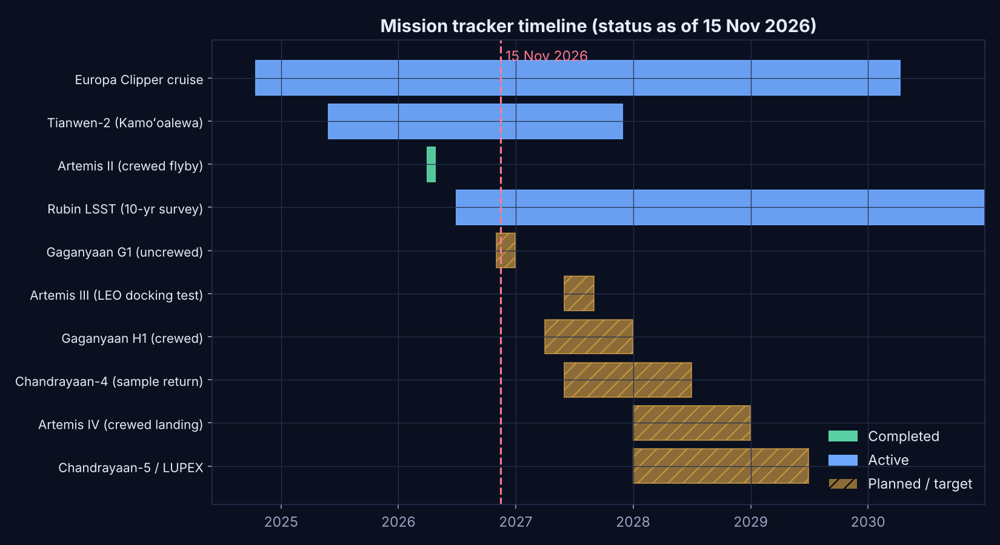
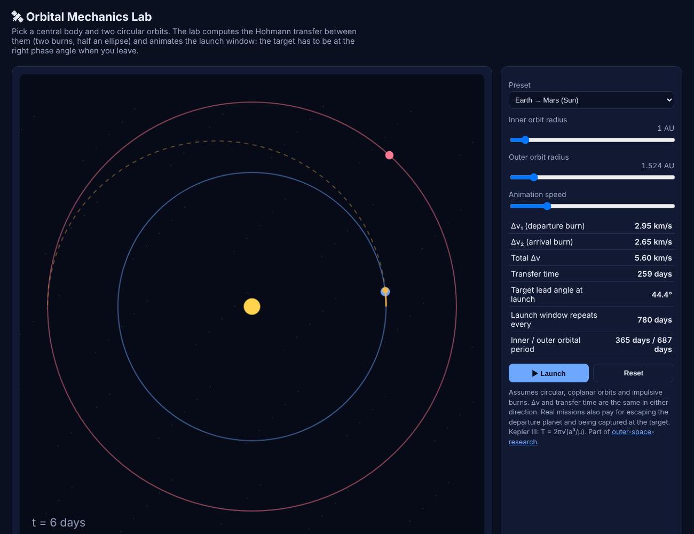
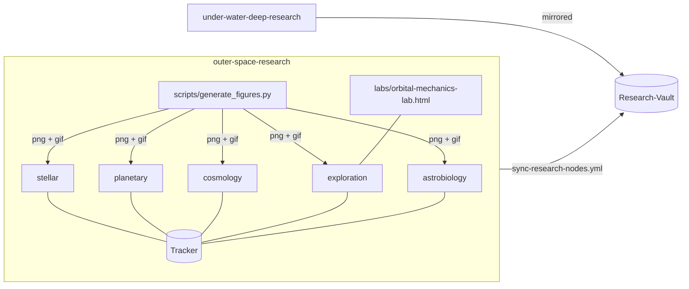

<div align="center">


# 🌌 Outer Space Research

### A sourced, visual research node on stars, planets, cosmology, missions and the search for life, synced into the Research-Vault hub

    

[](LICENSE)     [](https://github.com/shiroonigami23-ui/outer-space-research/actions/workflows/validate.yml) 

[](https://codespaces.new/shiroonigami23-ui/outer-space-research?quickstart=1) [](https://github.com/shiroonigami23-ui/outer-space-research/archive/refs/heads/main.zip)

[**Overview**](#-overview) · [**Tracks**](#-research-tracks) · [**Tracker**](#-latest-tracker) · [**Lab**](#-interactive-orbital-mechanics-lab) · [**Architecture**](#-architecture) · [**Getting Started**](#-getting-started) · [**Roadmap**](#-roadmap)

</div>

---

## 📖 Overview

**Outer Space Research** collects concepts, open questions, dated studies and evidence on astronomy, astrophysics
and space exploration. Every factual claim has a dated source, and every figure is regenerated from code. The repo is
**mirrored automatically** into [Research-Vault](https://github.com/shiroonigami23-ui/Research-Vault)
(`connected/outer-space-research/`) by the hub's `sync-research-nodes.yml` workflow, using the same model and
template as its sister node [under-water-deep-research](https://github.com/shiroonigami23-ui/under-water-deep-research).

### ✨ Highlights

- **Five research tracks**: stellar, planetary, cosmology, exploration and astrobiology. Each one goes concepts → open questions → dated studies → sources.
- **Live mission tracker** with status and next milestones for Artemis, Gaganyaan, Chandrayaan, Europa Clipper, Tianwen-2, Rubin, DESI and JWST
- **12 original figures + an animated GIF**, all rebuilt by one script (`scripts/generate_figures.py`)
- **Interactive orbital-mechanics lab** (single HTML file): Hohmann transfers, Δv, launch windows
- **CI** regenerates every figure and checks every Markdown link on each push

<div align="center">

 

</div>

## 🔭 Research Tracks

| Track | What it covers | Key note | Preview |
|---|---|---|---|
| ⭐ [**stellar/**](stellar/) | Star lifecycles, HR diagram, 6,000+ exoplanets | [stellar-evolution-and-exoplanets.md](stellar/stellar-evolution-and-exoplanets.md) |  |
| 🪐 [**planetary/**](planetary/) | Mars (Sapphire Canyon), Europa, Enceladus, Titan, Kamoʻoalewa | [solar-system-worlds.md](planetary/solar-system-worlds.md) |  |
| 🌌 [**cosmology/**](cosmology/) | CMB, ΛCDM, DESI evolving dark energy, Hubble tension, MoM-z14 | [cosmology-core.md](cosmology/cosmology-core.md) |  |
| 🚀 [**exploration/**](exploration/) | Artemis, Gaganyaan, Chandrayaan, Europa Clipper, Tianwen-2, Rubin | [missions-and-instruments.md](exploration/missions-and-instruments.md) |  |
| 🧬 [**astrobiology/**](astrobiology/) | Biosignatures, CoLD scale, K2-18 b debate, Mars, Venus, Enceladus | [biosignatures-and-habitability.md](astrobiology/biosignatures-and-habitability.md) |  |

## 🗓 Latest Tracker

Snapshot from **[LATEST-ONGOING-RESEARCH-TRACKER.md](LATEST-ONGOING-RESEARCH-TRACKER.md)** (15 Nov 2026):

| Stream | Status | Next |
|---|---|---|
| Artemis | Artemis II crew flew around the Moon, 1–10 Apr 2026 | Artemis III LEO docking test (2027), landing on Artemis IV (2028) |
| Gaganyaan | Separation tests passed (Oct 2026) | Uncrewed G1, Q4 2026 |
| Europa Clipper | Cruising, healthy | Earth flyby **3 Dec 2026** |
| Tianwen-2 | At quasi-moon Kamoʻoalewa | Sample return Nov 2027 |
| Rubin LSST | 10-year survey started 30 Jun 2026 | First data previews |
| DESI | Dark energy may be weakening (2.8–4.2σ) | More data, Euclid |

## 🛰 Interactive Orbital-Mechanics Lab

[`labs/orbital-mechanics-lab.html`](labs/orbital-mechanics-lab.html) is a single file with no dependencies. Download it and open it in any browser.
Pick Earth→Mars, Venus↔Earth, Earth→Jupiter or LEO→GEO, drag the orbit radii, and watch the transfer, Δv, transfer time,
phase angle and launch-window period update live. Add `#launch` to the URL to auto-start.

<div align="center"></div>

## 🧩 Features

| Feature | What it does |
|---|---|
| **Track template** | Same structure as the deep-ocean node: `README.md` gallery + notes file + `png/` |
| **Dated sources** | Every note carries a status date; every claim links to a source |
| **Figure pipeline** | `scripts/generate_figures.py` rebuilds all diagrams from formulas and cited values |
| **Link checker** | `scripts/check_links.py` fails CI on any broken relative link or image |
| **Vault sync** | Research-Vault's `sync-research-nodes.yml` mirrors this node into `connected/` |

## 🛠 Tech Stack

| Layer | Technology |
|---|---|
| Content | Markdown |
| Figures | Python · NumPy · Matplotlib · Pillow |
| Interactive lab | HTML5 Canvas · vanilla JavaScript |
| Automation | GitHub Actions (`validate.yml` here, sync workflow in Research-Vault) |

## 🏗 Architecture

Each track is self-contained; the tracker and figure script tie them together, and Research-Vault mirrors the whole node.



➡️ Full design notes, data flow and design decisions: **[docs/ARCHITECTURE.md](docs/ARCHITECTURE.md)**

## 📁 Project Structure

```text
outer-space-research/
├── README.md
├── LATEST-ONGOING-RESEARCH-TRACKER.md   # dated status board + monthly digest
├── IMAGE-SOURCES.md                     # how every figure was made / credited
├── stellar/        README.md · stellar-evolution-and-exoplanets.md · png/
├── planetary/      README.md · solar-system-worlds.md · png/
├── cosmology/      README.md · cosmology-core.md · png/
├── exploration/    README.md · missions-and-instruments.md · png/
├── astrobiology/   README.md · biosignatures-and-habitability.md · png/
├── labs/orbital-mechanics-lab.html      # interactive Hohmann-transfer lab
├── gifs/hohmann_transfer.gif
├── scripts/        generate_figures.py · check_links.py · requirements.txt
├── docs/           ARCHITECTURE.md · ROADMAP.md · orbital-lab-screenshot.png
├── assets/hubble-extreme-deep-field.jpg
├── connected/Research-Vault-README.md
└── .github/workflows/validate.yml
```

## 🚀 Getting Started

### 1. Get the code

Pick whichever method suits you:

| Method | Command |
|---|---|
| **HTTPS** | `git clone https://github.com/shiroonigami23-ui/outer-space-research.git` |
| **SSH** | `git clone git@github.com:shiroonigami23-ui/outer-space-research.git` |
| **GitHub CLI** | `gh repo clone shiroonigami23-ui/outer-space-research` |
| **ZIP** | [Download](https://github.com/shiroonigami23-ui/outer-space-research/archive/refs/heads/main.zip) and extract |
| **Codespaces** | [Open in browser](https://codespaces.new/shiroonigami23-ui/outer-space-research?quickstart=1). No local setup; the dev container is preconfigured |

> 🔑 **Using SSH for the first time?** Generate a key with `ssh-keygen -t ed25519 -C "you@example.com"`, add the `.pub` contents at **GitHub → Settings → SSH and GPG keys**, then test with `ssh -T git@github.com`.

### 2. Install & set up (only needed to rebuild figures)

```bash
cd outer-space-research
python -m pip install -r scripts/requirements.txt
```

### 3. Run

```bash
python scripts/generate_figures.py   # rebuilds every png + the GIF
python scripts/check_links.py        # verifies all Markdown links/images
# open labs/orbital-mechanics-lab.html in a browser for the interactive lab
```

Or just read the tracks on GitHub, or browse the mirrored copy in Research-Vault under `connected/outer-space-research/`.

## 🎮 Usage

- **Studying a topic**: open a track's `README.md` for the gallery and summary, then its notes file for detail and sources.
- **Checking what's happening now**: read the [tracker](LATEST-ONGOING-RESEARCH-TRACKER.md). The monthly digest is at the bottom.
- **Adding a study**: add a dated bullet under *Dated Studies* in the right notes file, cite the source, and update the tracker if it changes a status.
- **Adding a figure**: write a function in `scripts/generate_figures.py`, run it, then reference the PNG in the track README and `IMAGE-SOURCES.md`.

## 🗺 Roadmap

**Phase 1 — Node setup (done)**

- [x] Repository connected to Research-Vault sync

**Phase 2 — Tracks (done)**

- [x] Stellar evolution and exoplanet notes
- [x] Planetary science (Mars, Europa, Enceladus, Titan, Kamoʻoalewa)
- [x] Cosmology (CMB, dark matter/energy, DESI, JWST early galaxies)
- [x] Astrobiology (biosignatures, CoLD scale, case studies)
- [x] Missions tracker with dated sources (Artemis, Gaganyaan, Chandrayaan, Europa Clipper, Tianwen-2, Rubin)

**Phase 3 — Interactive**

- [x] Interactive orbital-mechanics lab (HTML/JS)
- [x] Reproducible figure pipeline + CI link check
- [ ] Public-domain NASA image gallery per track
- [ ] Monthly digest in the tracker (first entry: Nov 2026, so keep it going)
- [ ] Second lab: exoplanet transit light-curve simulator

➡️ Details: **[docs/ROADMAP.md](docs/ROADMAP.md)**

## 🤝 Contributing

Contributions, issues and feature requests are welcome!

1. Fork the repository
2. Create a feature branch: `git checkout -b feature/amazing-feature`
3. Commit your changes: `git commit -m "feat: add amazing feature"`
4. Push the branch: `git push origin feature/amazing-feature`
5. Open a Pull Request against `main`

Check the [issues page](https://github.com/shiroonigami23-ui/outer-space-research/issues) and the [roadmap](docs/ROADMAP.md) for ideas on where to help.

## 📜 Changelog

See [CHANGELOG.md](CHANGELOG.md) for the release history.

## 📄 License

Distributed under the **MIT** license. See [LICENSE](LICENSE) for details.

## 👤 Author

**Aryan Singh Chandel** (Shiro)

[](https://github.com/shiroonigami23-ui)

<div align="center">

⭐ **If you find this project useful, consider giving it a star!** ⭐

</div>
