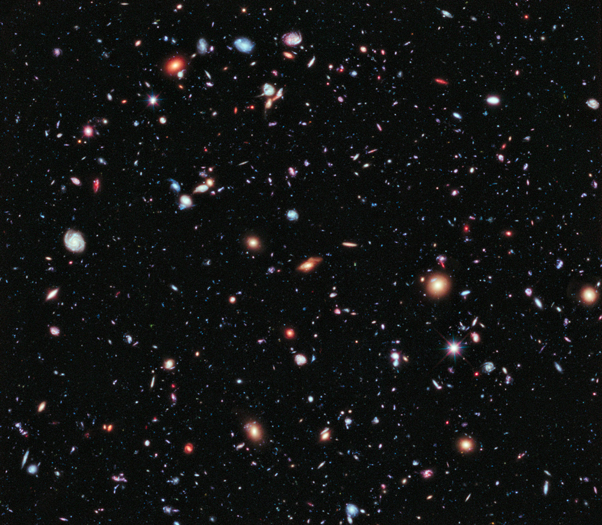
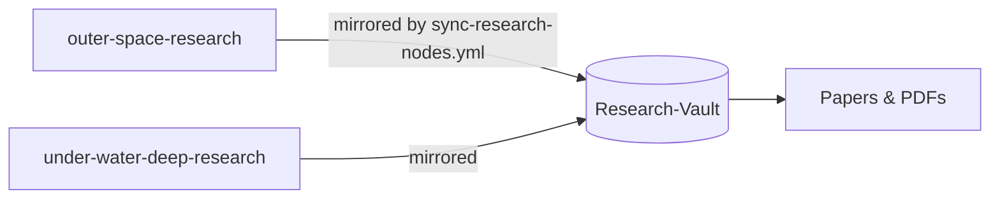

<div align="center">



<sub>Hubble eXtreme Deep Field — almost every dot is a galaxy. Credit: NASA, ESA (public domain), via scikit-image sample data</sub>

# 🌌 Outer Space Research

### A research node on astronomy and space science, synced into the Research-Vault hub

 

[](LICENSE)    

[](https://codespaces.new/shiroonigami23-ui/outer-space-research?quickstart=1) [](https://github.com/shiroonigami23-ui/outer-space-research/archive/refs/heads/main.zip)

[**Overview**](#-overview) · [**Features**](#-features) · [**Architecture**](#-architecture) · [**Getting Started**](#-getting-started) · [**Roadmap**](#-roadmap)

</div>

---

## 📖 Overview

**Outer Space Research** is a research node in my knowledge network. It collects notes, questions and sources on
astronomy, astrophysics and space exploration, and is **mirrored automatically** into
[Research-Vault](https://github.com/shiroonigami23-ui/Research-Vault) (`connected/outer-space-research/`) by the hub's
`sync-research-nodes.yml` workflow — the same model used by
[under-water-deep-research](https://github.com/shiroonigami23-ui/under-water-deep-research).

### ✨ Highlights

- **Hub-and-spoke research** — this node stays focused; the Vault aggregates everything
- **Automatic sync** via a GitHub Actions workflow in Research-Vault
- **Same template** as the deep-ocean node: concepts → open questions → dated studies → evidence

## 🧩 Features

| Feature | What it does |
|---|---|
| **Connection model** | Research-Vault is the source of truth; this repo is a mirrored node |
| **Sync workflow** | `sync-research-nodes.yml` in Research-Vault copies this node into `connected/` |
| **Hub README** | `connected/Research-Vault-README.md` documents the link |

## 🛠 Tech Stack

| Layer | Technology |
|---|---|
| Content | Markdown |
| Automation | GitHub Actions (in Research-Vault) |

## 🏗 Architecture

Research nodes are independent repos; Research-Vault pulls them together.



➡️ Full design notes, data flow and design decisions: **[docs/ARCHITECTURE.md](docs/ARCHITECTURE.md)**

## 📁 Project Structure

```text
outer-space-research/
├── README.md
└── connected/Research-Vault-README.md
```

## 🚀 Getting Started

### 1. Get the code

Pick whichever method suits you:

| Method | Command |
|---|---|
| **HTTPS** | `git clone https://github.com/shiroonigami23-ui/outer-space-research.git` |
| **SSH** | `git clone git@github.com:shiroonigami23-ui/outer-space-research.git` |
| **GitHub CLI** | `gh repo clone shiroonigami23-ui/outer-space-research` |
| **ZIP** | [Download](https://github.com/shiroonigami23-ui/outer-space-research/archive/refs/heads/main.zip) and extract |
| **Codespaces** | [Open in browser](https://codespaces.new/shiroonigami23-ui/outer-space-research?quickstart=1) — zero local setup, dev container preconfigured |

> 🔑 **Using SSH for the first time?** Generate a key with `ssh-keygen -t ed25519 -C "you@example.com"`, add the `.pub` contents at **GitHub → Settings → SSH and GPG keys**, then test with `ssh -T git@github.com`.

### 2. Install & set up

```bash
cd outer-space-research
# no build step required
```

### 3. Run

Read on GitHub, or browse the aggregated copy in Research-Vault under `connected/outer-space-research/`.

## 🎮 Usage

**Planned tracks** (mirroring the deep-ocean node's structure): `stellar/`, `planetary/`, `cosmology/`,
`exploration/` (missions & instruments) and `astrobiology/`, each with concepts, open questions, dated studies and credited visuals.

## 🗺 Roadmap

**Phase 1 — Node setup (done)**

- [x] Repository connected to Research-Vault sync

**Phase 2 — Tracks**

- [ ] Stellar evolution and exoplanet notes
- [ ] Planetary science (Mars, Europa, Titan)
- [ ] Cosmology (CMB, dark matter/energy, JWST early galaxies)
- [ ] Missions tracker with dated sources (JWST, Artemis, Chandrayaan, Gaganyaan)

**Phase 3 — Interactive**

- [ ] Interactive orbital-mechanics lab (HTML/JS)
- [ ] Public-domain NASA image gallery per track
- [ ] Monthly digest in the tracker

➡️ Detailed plan, milestones and long-term vision: **[docs/ROADMAP.md](docs/ROADMAP.md)**

## 🤝 Contributing

Contributions, issues and feature requests are welcome!

1. Fork the repository
2. Create a feature branch: `git checkout -b feature/amazing-feature`
3. Commit your changes: `git commit -m "feat: add amazing feature"`
4. Push the branch: `git push origin feature/amazing-feature`
5. Open a Pull Request against `main`

Check the [issues page](https://github.com/shiroonigami23-ui/outer-space-research/issues) and the [roadmap](docs/ROADMAP.md) for ideas on where to help.

## 📜 Changelog

See [CHANGELOG.md](CHANGELOG.md) for the release history.

## 📄 License

Distributed under the **MIT** license. See [LICENSE](LICENSE) for details.

## 👤 Author

**Aryan Singh Chandel** (Shiro)

[](https://github.com/shiroonigami23-ui)

<div align="center">

⭐ **If you find this project useful, consider giving it a star!** ⭐

</div>
