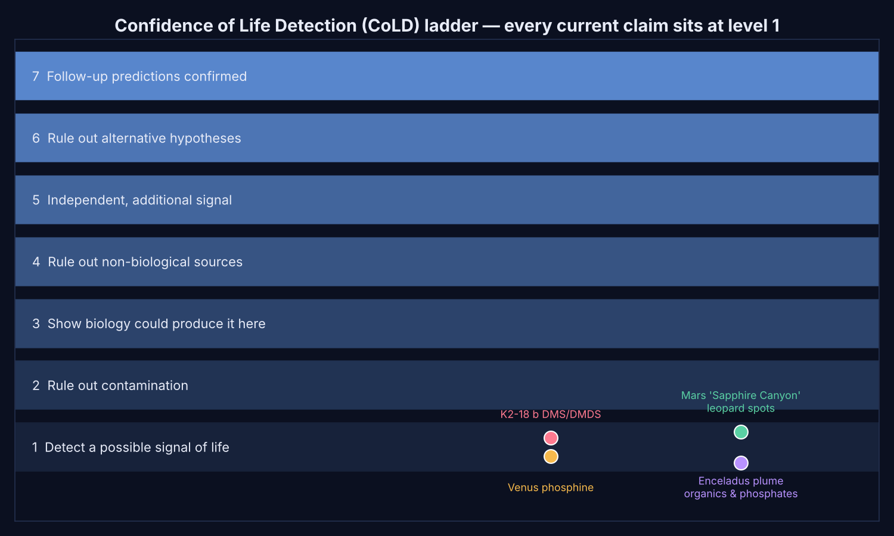
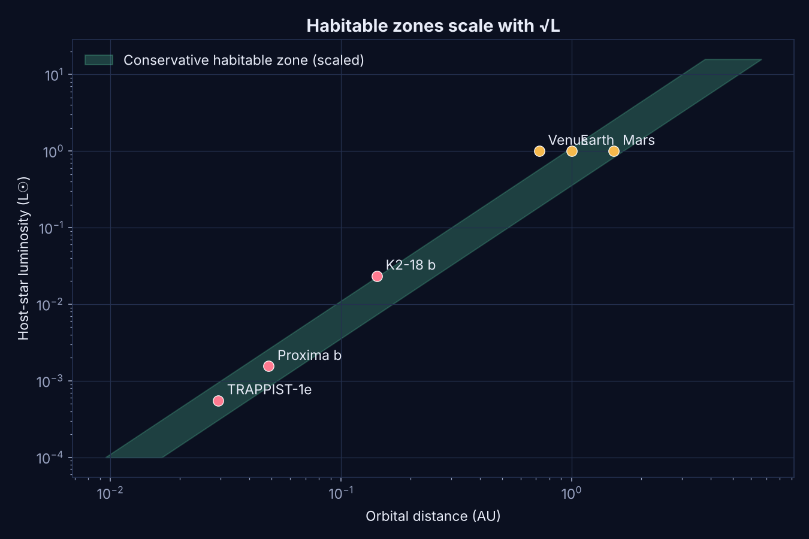

# 🧬 Astrobiology — searching for life

How we would know if we found life, and why every claim so far is still at step one.

## Pattern Summary

- A **biosignature** is a clue, not proof. Most proposed signals have plausible non-biological explanations.
- NASA's CoLD scale (Confidence of Life Detection) turns "is it life?" into seven checkable steps. Current claims sit at the first steps.
- The strongest near-term tests are **sample return** (Mars) and **repeat observations with independent instruments** (exoplanet atmospheres).

## Gallery

## Notes

- [`biosignatures-and-habitability.md`](./biosignatures-and-habitability.md): case studies (K2-18 b, Mars, Venus, Enceladus) and sources

Cross-link: the deep-sea chemosynthesis notes in [under-water-deep-research](https://github.com/shiroonigami23-ui/under-water-deep-research) are the Earth analogue for ocean-world life.
