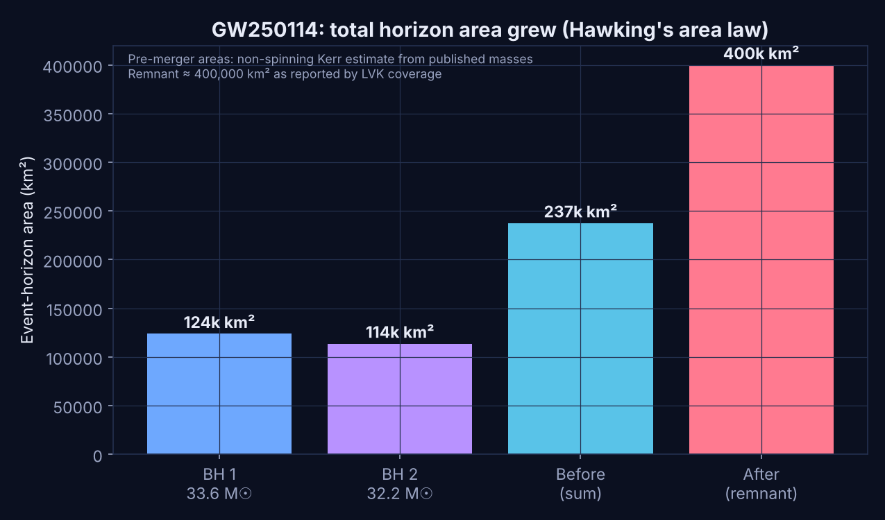
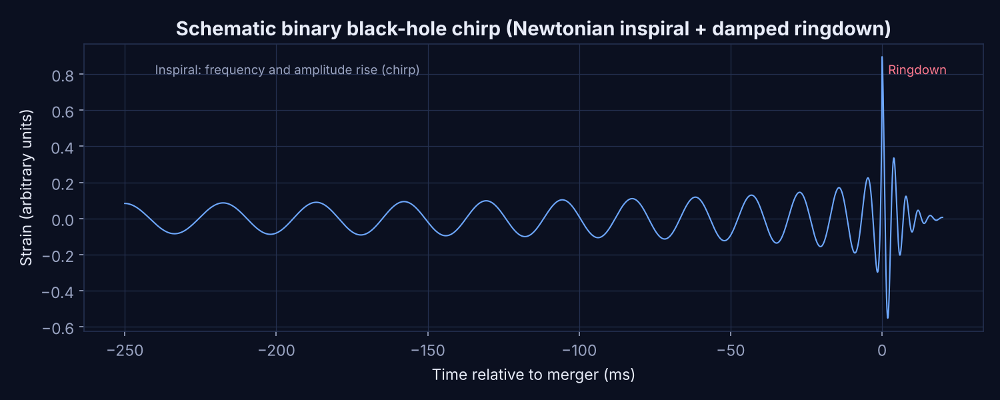

# 🕳 Black Holes and Gravitational Waves

Hearing spacetime ring, and testing Hawking and Kerr with it.

## Pattern Summary

- **GW250114** (14 Jan 2025) is the loudest gravitational-wave signal so far (network SNR ≈ 80), about three times clearer than the first detection, GW150914.
- It confirms **Hawking's area theorem** (total horizon area can't shrink) at ~99.999% confidence, up from ~95% in 2021. It also shows the remnant rings like a **Kerr** black hole, with two ringdown tones identified.
- The LIGO–Virgo–KAGRA network now detects mergers every few days.

## Gallery

## Notes

- [`gravitational-waves-and-black-holes.md`](./gravitational-waves-and-black-holes.md)
