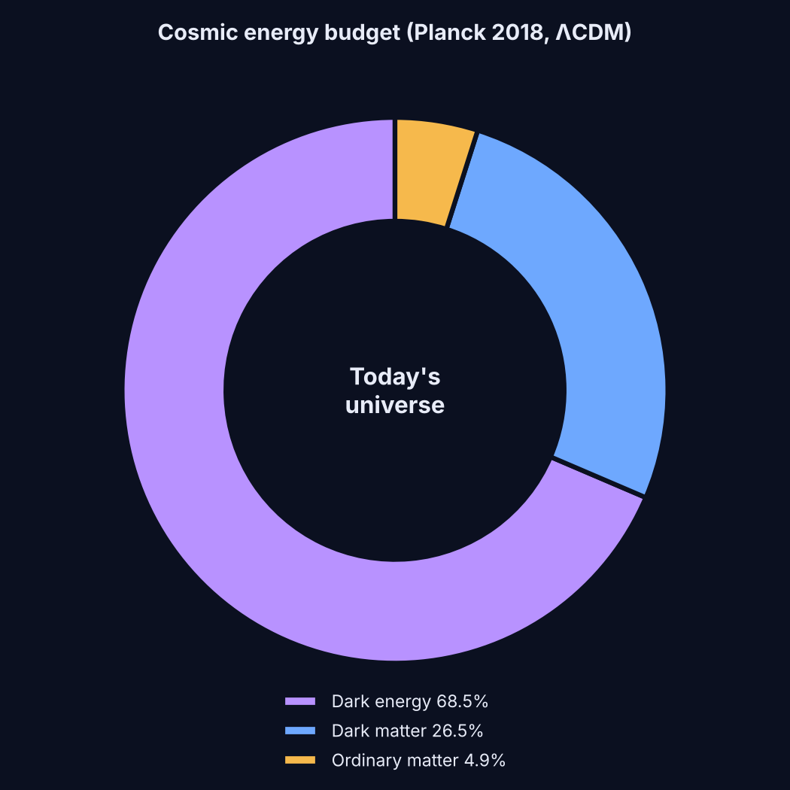
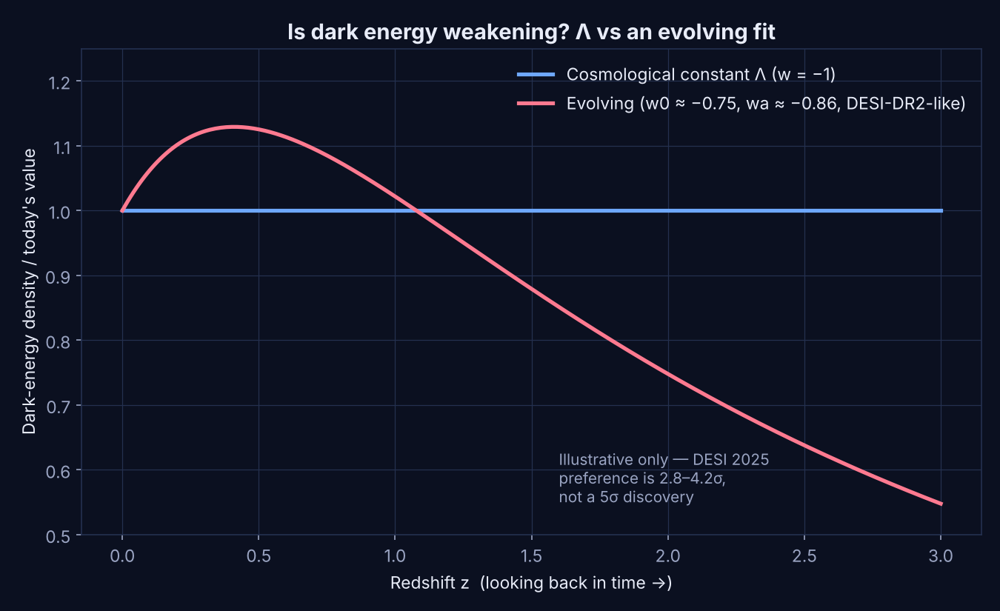
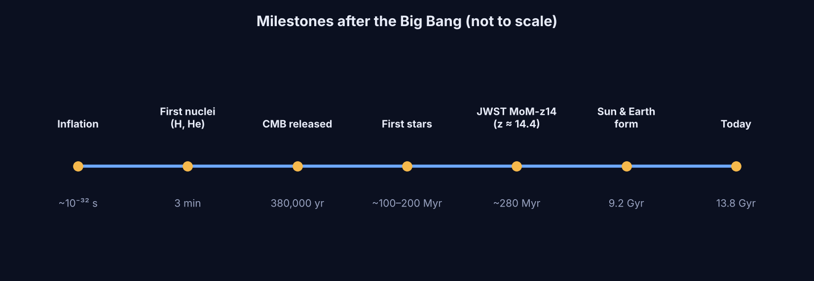

# 🌌 Cosmology — the universe as a whole

What the universe is made of, how it began, and why it is expanding faster.

## Pattern Summary

- The standard model (ΛCDM) fits the cosmic microwave background very well, with ~5% ordinary matter, ~27% dark matter and ~68% dark energy.
- DESI's 2025 results hint that dark energy may be **weakening over time**. The hint is real but not yet a discovery (below 5σ).
- JWST keeps finding bright galaxies earlier than models expected, with the record now at **z ≈ 14.44 (~280 Myr after the Big Bang)**.

## Gallery

## Notes

- [`cosmology-core.md`](./cosmology-core.md): CMB, ΛCDM, DESI, the Hubble tension and early galaxies
