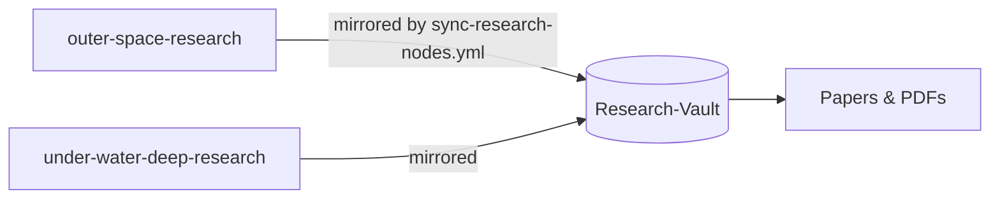

# 🏗 Architecture — Outer Space Research

> Part of [outer-space-research](https://github.com/shiroonigami23-ui/outer-space-research). Back to the [README](../README.md).

## 1. System Overview

Each research topic lives in its own repository so it can evolve independently. Research-Vault runs a scheduled
workflow that mirrors all nodes into one place for browsing and cross-linking.

## 2. Components

| Component | Location | Responsibility |
|---|---|---|
| **Node README** | `README.md` | Scope and connection model |
| **Hub link** | `connected/Research-Vault-README.md` | Pointer to the Vault |

## 3. Data / Control Flow

1. Notes are added here.
2. The Vault workflow copies this repo into `connected/outer-space-research/`.

## 4. Key Design Decisions

| Decision | Rationale |
|---|---|
| Separate repos per topic | Clean history, focused issues, independent visibility |

## 5. Known Limitations

- Content tracks are still being written

---
*Last updated: 2026-11-13*
