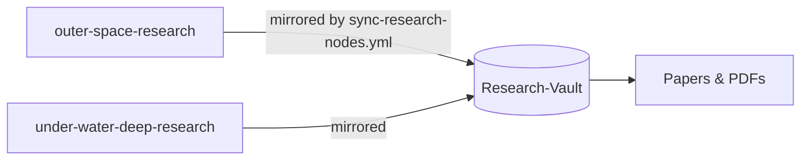

# 🏗 Architecture — Outer Space Research

> Part of [outer-space-research](https://github.com/shiroonigami23-ui/outer-space-research). Back to the [README](../README.md).

## 1. System Overview

Each research topic lives in its own repository so it can evolve independently. Research-Vault runs a scheduled
workflow that mirrors all nodes into one place for browsing and cross-linking.

## 2. Components

| Component | Location | Responsibility |
|---|---|---|
| **Node README** | `README.md` | Entry point: tracks, tracker snapshot, lab, setup |
| **Research tracks** | `stellar/`, `planetary/`, `cosmology/`, `exploration/`, `astrobiology/` | Each has a gallery `README.md`, a dated notes file and a `png/` folder |
| **Tracker** | `LATEST-ONGOING-RESEARCH-TRACKER.md` | Status board, next milestones, monthly digest |
| **Figure pipeline** | `scripts/generate_figures.py` | Builds every `*_generated.png` and the Hohmann GIF from formulas + cited values |
| **Link checker** | `scripts/check_links.py` | Fails if a relative Markdown link or image is missing (skips mirrored `connected/`) |
| **Orbital lab** | `labs/orbital-mechanics-lab.html` | Self-contained canvas app: vis-viva, Kepler's equation, launch windows |
| **Attribution** | `IMAGE-SOURCES.md` | How each image was made or where it came from |
| **CI** | `.github/workflows/validate.yml` | Regenerates figures and checks links on every push/PR |
| **Hub link** | `connected/Research-Vault-README.md` | Pointer to the Vault |

## 3. Data / Control Flow

1. A new study or mission update is added as a dated bullet in the relevant track notes, with its source.
2. If it changes a status, the tracker row and monthly digest are updated.
3. If it needs a figure, a function is added to `generate_figures.py`; the PNG is referenced from the track README and `IMAGE-SOURCES.md`.
4. CI regenerates figures and checks links.
5. The Research-Vault workflow copies this repo into `connected/outer-space-research/`.

## 4. Key Design Decisions

| Decision | Rationale |
|---|---|
| Separate repos per topic | Clean history, focused issues, independent visibility |
| Same template as the deep-ocean node | One mental model across nodes; easy cross-linking |
| Figures generated from code, not hand-made | Reproducible, auditable numbers, no licensing questions |
| Status dates on every notes file | Space news goes stale fast; readers can see how old each claim is |
| Single-file HTML lab | Works offline, no build step, easy to mirror into the Vault |

## 5. Known Limitations

- Mission dates are agency targets and slip often. The tracker needs monthly refreshes.
- No NASA public-domain photo gallery yet; current visuals are generated diagrams.
- The lab assumes circular, coplanar orbits and impulsive burns.

---
*Last updated: 2026-11-15*
