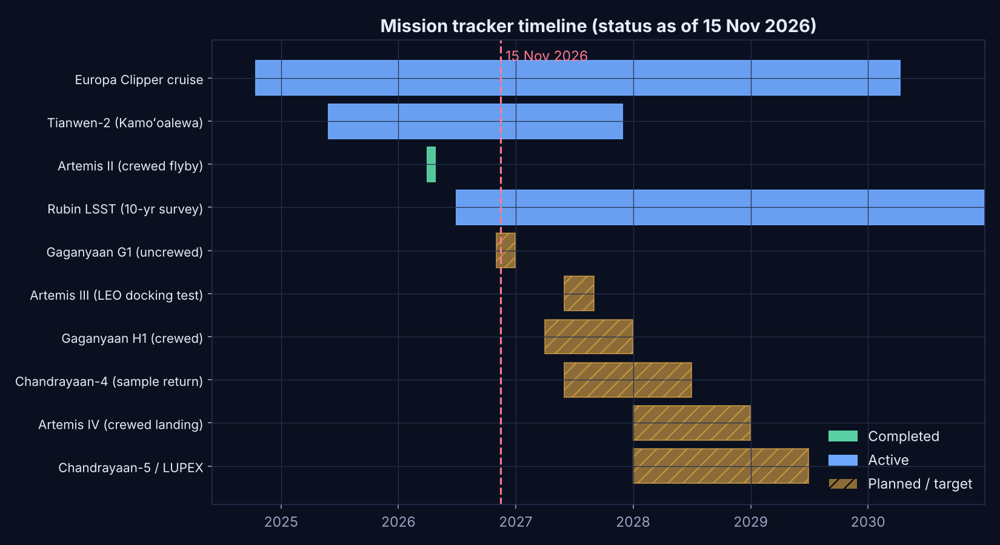
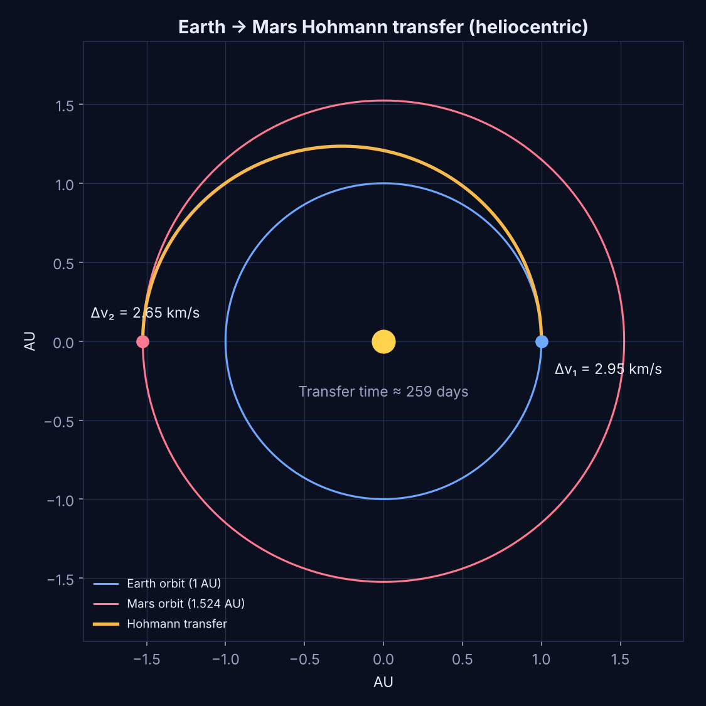
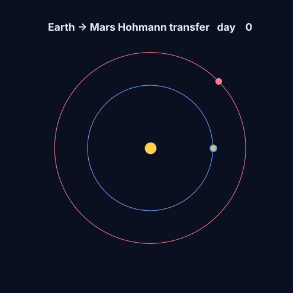

# 🚀 Exploration — missions and instruments

Who is flying where, when, and what each mission is meant to prove. Dates are kept current in the [tracker](../LATEST-ONGOING-RESEARCH-TRACKER.md).

## Pattern Summary

- 2026 is the year crewed deep-space flight resumed: **Artemis II** flew four people around the Moon (1–10 April).
- Programmes are adding more **test flights before landings**: Artemis III became a low-Earth-orbit docking test and the landing moved to Artemis IV (2028). Gaganyaan flies three uncrewed missions before crew.
- Sample return is the new standard for decisive science (Chandrayaan-4, Tianwen-2, the Mars cache).

## Gallery

## Notes

- [`missions-and-instruments.md`](./missions-and-instruments.md): mission cards with dated sources
- [`../labs/orbital-mechanics-lab.html`](../labs/orbital-mechanics-lab.html): interactive orbit and transfer lab
