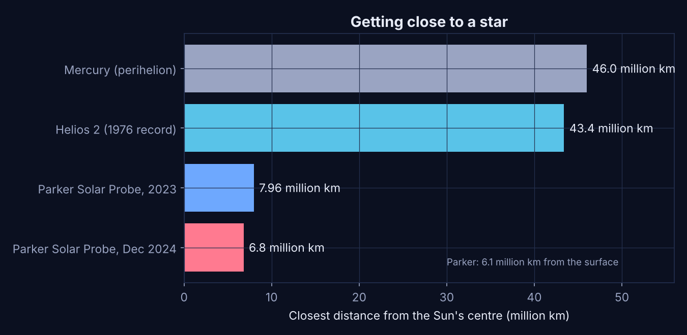

# ☀️ Heliophysics — the Sun and space weather

Touching the corona, and why the solar wind matters for Earth.

## Pattern Summary

- **Parker Solar Probe** flew 6.1 million km from the Sun's surface on 24 Dec 2024 at ~692,000 km/h. That is the closest and fastest any human-made object has gone. It repeated the pass in March and June 2025 and on into 2026.
- Its data are pinning down how the solar wind is accelerated and how particles reach half the speed of light in CME shocks. Both are key to **space-weather forecasting**.
- Its next mission phase (late 2026+) is under NASA review.

## Gallery

## Notes

- [`parker-and-space-weather.md`](./parker-and-space-weather.md)
