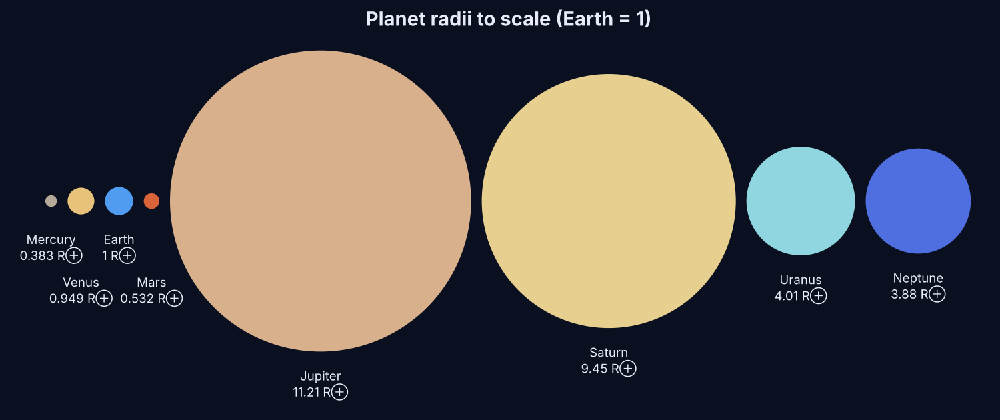
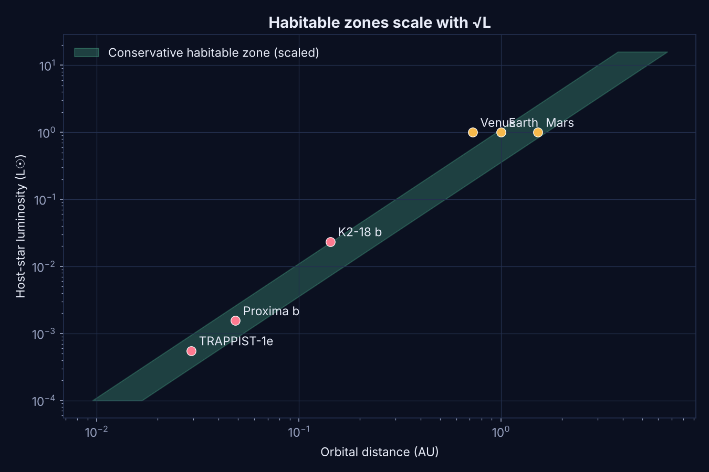

# 🪐 Planetary — worlds of the Solar System

Mars, the icy ocean moons and the small bodies that record the Solar System's history.

## Pattern Summary

- Liquid water is common in the outer Solar System, but it is hidden **under ice** (Europa, Enceladus, Titan, Ganymede).
- Mars was wet billions of years ago. Its sedimentary rocks are now the best place to look for fossil microbial chemistry.
- Small bodies such as asteroids and quasi-moons preserve early material. Sample return is the only way to get lab-grade answers.

## Gallery

## Notes

- [`solar-system-worlds.md`](./solar-system-worlds.md): Mars, Europa, Enceladus, Titan and Kamoʻoalewa with dated sources
