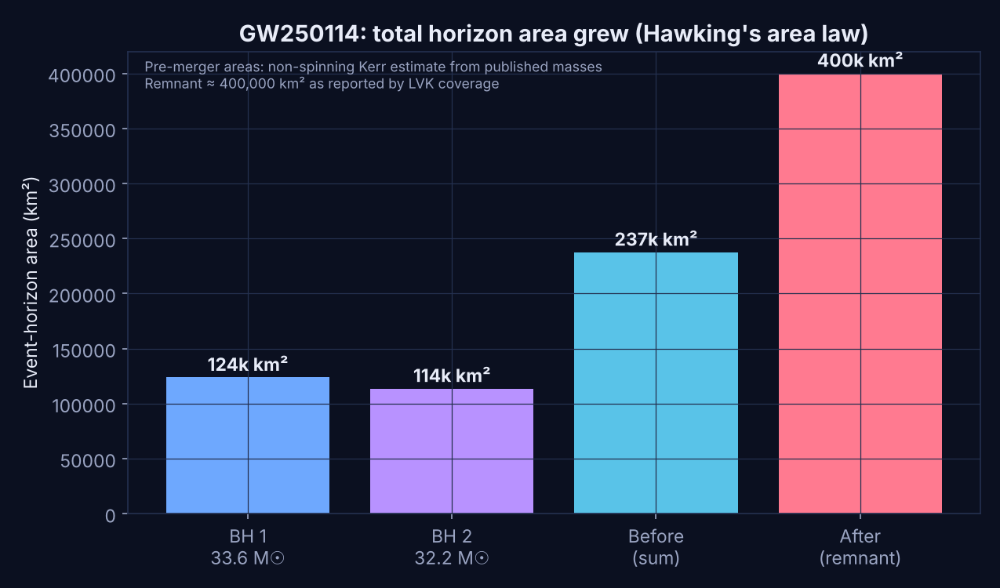

{{chart:gw}}

## What they are

Accelerating masses create ripples in spacetime that travel at the speed of light, stretching and squeezing everything they pass through, by less than a thousandth of a proton's width over LIGO's 4 km arms.

## Milestones

1916: Einstein predicts gravitational waves.

1974: The Hulse–Taylor binary pulsar's shrinking orbit matches predictions (Nobel 1993).

2015: <b>GW150914</b>, two black holes of ~36 and ~29 Suns merging 1.3 billion light-years away (Nobel 2017 for Weiss, Barish and Thorne).

2017: <b>GW170817</b>, a neutron-star merger also seen as a kilonova and gamma-ray burst, the birth of multi-messenger astronomy.

2023: Pulsar timing arrays (NANOGrav, EPTA, InPTA with India's GMRT, PPTA) detect a gravitational-wave background.

2025: <b>GW250114</b>, the clearest signal yet, confirming Hawking's black-hole area theorem at very high confidence.

## Detectors

| Detector | Where | Status |
|---|---|---|
| LIGO (2 sites) | USA | Operating |
| Virgo | Italy | Operating |
| KAGRA | Japan (underground) | Operating |
| **LIGO-India** | Hingoli, Maharashtra | Under construction (~2030s) |
| LISA | Space (ESA) | Launch planned ~2035 |
| Einstein Telescope, Cosmic Explorer | Europe, USA | Planned |

## Listening to a chirp

When converted to sound, a black-hole merger is a rising 'chirp' lasting a fraction of a second. Click 🔊 on [Black hole merger](/wiki/objects/black-hole-merger.html) to hear one.

Research details: [Research: gravitational waves](/wiki/research/gravitational-waves-now.html) · [LVK 2025 analysis](/wiki/library/lvk-2025.html).
