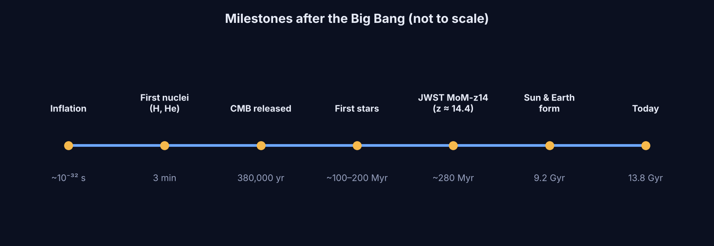

The **Big Bang** is not an explosion *in* space. It is the expansion *of* space itself from an extremely hot, dense early state about **13.8 billion years ago**. Every distant galaxy is moving away from every other, like raisins in rising dough.

## The first moments

:::collapse !A timeline of the first 380,000 years

0 – 10⁻⁴³ s: <b>Planck era.</b> Known physics breaks down; gravity and quantum mechanics would need to be unified.

~10⁻³⁶ – 10⁻³² s: <b>Inflation.</b> Space expands by a factor of at least 10²⁶ in a tiny fraction of a second, smoothing the universe and stretching quantum ripples into the seeds of galaxies.

10⁻¹² s: The electroweak force splits; particles gain mass through the Higgs field.

10⁻⁶ s: Quarks bind into protons and neutrons. A tiny excess of matter over antimatter (about 1 part in a billion) survives annihilation; everything we see comes from it.

1 s: Neutrinos decouple and stream freely (they still fill space as a cosmic neutrino background).

3 – 20 min: <b>Big Bang nucleosynthesis.</b> The universe acts as a fusion reactor, making ~75% hydrogen, ~25% helium and traces of lithium by mass.

~50,000 yr: Matter starts to dominate over radiation; dark matter begins clumping.

380,000 yr: <b>Recombination.</b> At ~3,000 K electrons join nuclei to make atoms, the universe becomes transparent, and the light released is the cosmic microwave background (CMB).

:::

## Four pillars of evidence

1. **Expansion.** Edwin Hubble (building on Henrietta Leavitt's Cepheid work and Vesto Slipher's redshifts) showed in 1929 that galaxies recede faster the farther away they are. Georges Lemaître had proposed an expanding universe from a 'primeval atom' in 1927.
2. **The cosmic microwave background.** Found by accident by Arno Penzias and Robert Wilson in 1965, it is a near-perfect 2.725 K glow from every direction. Its tiny ripples (1 part in 100,000) were mapped by COBE, WMAP and Planck.
3. **Light elements.** The measured cosmic abundances of hydrogen, helium and deuterium match the predictions of Big Bang nucleosynthesis.
4. **Evolution over time.** Distant (younger) galaxies look different from nearby ones: smaller, bluer and messier, exactly what JWST sees at record distances.

## What the Big Bang does *not* explain

:::debate Open questions
- **What came 'before', or whether 'before' makes sense.** Time itself may begin with the Big Bang.
- **What drove inflation.** It is supported by the CMB's flatness and fluctuation pattern but not directly proven (gravitational-wave 'B-modes' have not been found).
- **Why there is more matter than antimatter.**
- **The Hubble tension.** Local measurements give ~73 km/s/Mpc while the CMB predicts ~67.4; the CCHP team finds ~70.4. See [Research: cosmology](/wiki/research/cosmology-now.html).
:::

Next: [The Dark Ages and first stars](/wiki/cosmos/first-stars-and-galaxies.html).
