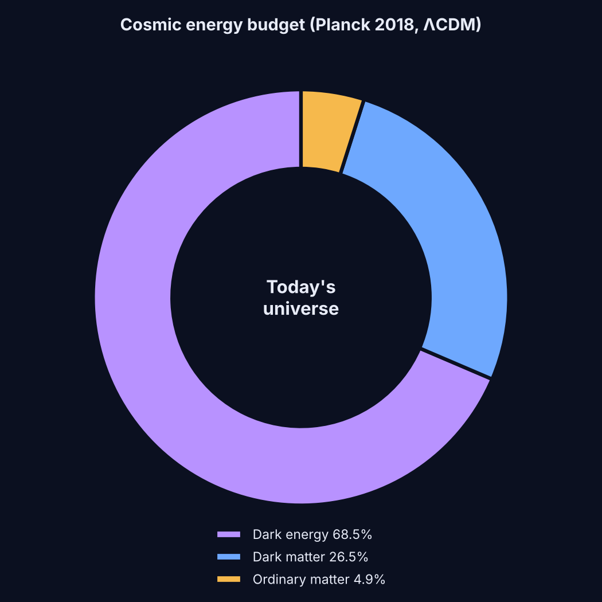
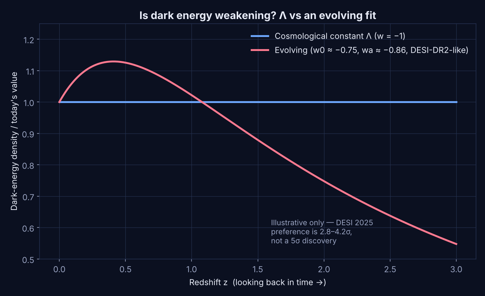

{{chart:budget}}

## Dark matter

- **Discovery:** Fritz Zwicky (1933) found galaxies in the Coma cluster moving too fast; Vera Rubin and Kent Ford (1970s) showed spiral galaxies rotate too fast at their edges.
- **Evidence today:** gravitational lensing, the Bullet Cluster (mass separated from hot gas), CMB fluctuation patterns, and the growth of cosmic structure.
- **Candidates:** WIMPs (not yet found in direct-detection experiments such as LZ), axions, sterile neutrinos and primordial black holes. Modified-gravity theories such as MOND explain some galaxy data but struggle with clusters and the CMB.

## Dark energy

In 1998 two teams measuring Type Ia supernovae found the expansion of the universe is **accelerating** (Nobel Prize 2011). The simplest explanation is Einstein's cosmological constant, the energy of empty space.

:::debate Is dark energy evolving?
The DESI collaboration's 2025 DR2 baryon-acoustic-oscillation results, combined with supernovae and the CMB, prefer a dark energy that weakens over time at **2.8–4.2σ**, depending on which supernova sample is used. That is suggestive but below the 5σ discovery threshold. Euclid and Rubin will test it. See [DESI 2025 analysis](/wiki/library/desi-2025.html).
:::

## Why it matters

Dark energy decides the fate of the universe; dark matter decides how galaxies formed. Together they are the biggest unsolved problem in physics. See [The fate of the universe](/wiki/cosmos/fate-of-the-universe.html).
