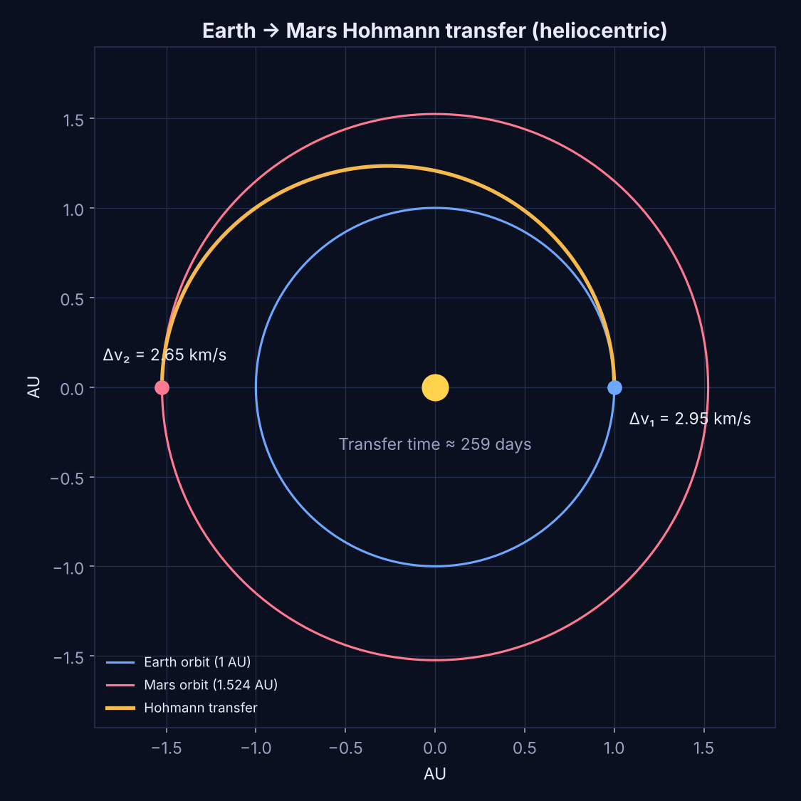

## Rockets

A rocket pushes exhaust backward and is pushed forward (Newton's third law); it doesn't need air to push against. The **Tsiolkovsky rocket equation** (1903) shows why rockets are mostly fuel: speed gained depends on exhaust velocity and the logarithm of the starting-to-final mass ratio. That is why rockets use **stages** and why **reusability** (Falcon 9, Starship) has slashed costs.

## Orbits are falling and missing

Throw a ball faster and it lands farther away. At ~7.8 km/s (about 28,000 km/h) at 400 km altitude, the ground curves away as fast as you fall: you are in orbit. Astronauts float because they and the station fall together, not because gravity is absent (it's ~90% of surface gravity at the ISS).

| Orbit | Altitude | Uses |
|---|---|---|
| Low Earth orbit (LEO) | 160–2,000 km | ISS, Tiangong, Starlink, Earth observation |
| Sun-synchronous | ~600–800 km | Imaging at the same local time |
| Medium Earth orbit | ~20,000 km | GPS, Galileo navigation |
| Geostationary (GEO) | 35,786 km | Communications, weather (INSAT/GSAT); satellites hover over one spot |
| Lagrange points | e.g. L1/L2, 1.5 million km | Aditya-L1 (L1), JWST and Gaia (L2) |

## Getting to other worlds

- **Escape velocity** from Earth is 11.2 km/s.
- A **Hohmann transfer** is the most fuel-efficient path between two orbits; to Mars it takes ~7–9 months and launch windows open every ~26 months.
- **Gravity assists** steal momentum from planets (Voyager's 'grand tour', Europa Clipper's Earth flyby in December 2026).

Try the [Orbital Mechanics Lab](/wiki/data/interactive-labs.html).

## Space debris

Over 30,000 tracked objects orbit Earth. Collisions could trigger a cascade (the Kessler syndrome). In 2019 India tested an anti-satellite missile (Mission Shakti) at low altitude so that most debris would re-enter quickly.
