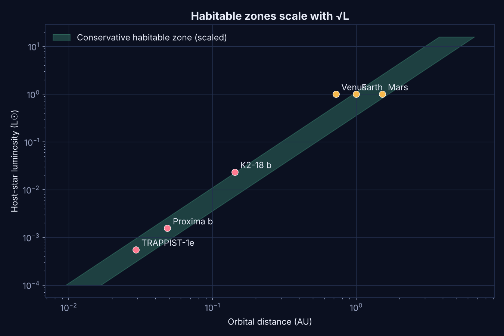

## What life needs (as far as we know)

Liquid water, an energy source (sunlight or chemistry), and elements such as carbon, hydrogen, nitrogen, oxygen, phosphorus and sulfur. Deep-sea vents show life can run on chemistry alone.

## The best places to look

| World | Why | Status |
|---|---|---|
| **Mars** | Ancient lakes and rivers; organic molecules | Perseverance's 2025 'potential biosignature' at Sapphire Canyon is unconfirmed; sample return was cancelled in 2026 |
| **Europa** | Salty ocean under ice | Europa Clipper arrives 2030 |
| **Enceladus** | Plumes containing water, salts, organics and phosphorus | Prime target for a future orbiter-lander |
| **Titan** | Methane lakes and a buried water ocean | Dragonfly launches ~2028 |
| **Venus clouds** | Temperate cloud layer | Phosphine claim disputed |
| **Exoplanets** | Billions of habitable-zone planets | JWST probing TRAPPIST-1 and K2-18 b |

## How we'd know: confidence levels

Scientists use a ladder of evidence (NASA's **CoLD** scale, Green et al. 2021) from 'signal detected' up to 'confirmed life'. Every current claim is on the lower rungs. See [Research: biosignatures](/wiki/research/biosignatures-now.html) and [K2-18 b debate](/wiki/library/k2-18b-debate.html).

## SETI and the Fermi paradox

Radio searches (Breakthrough Listen, SETI Institute) have found no technosignatures. If life is common, why haven't we seen anyone? Possible answers range from 'they are too far' to 'intelligent life is extraordinarily rare'.
