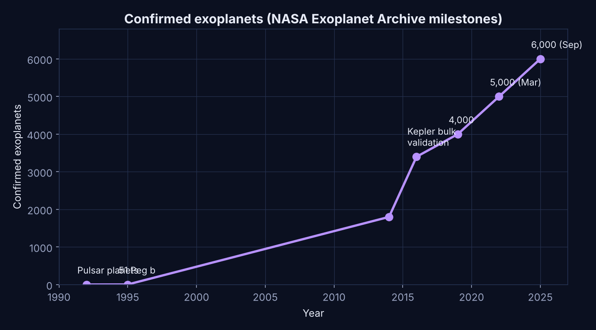

NASA's Exoplanet Archive passed **6,000 confirmed exoplanets** in 2025. Browse examples in the [Exoplanets](/wiki/exoplanets/index.html) catalog.

| Type | Description | Example |
|---|---|---|
| **Terrestrial (rocky)** | Earth-like composition | [TRAPPIST-1e](/wiki/exoplanets/trappist-1e.html) |
| **Super-Earth** | Up to ~1.6–2 Earth radii, likely rocky | LHS 1140 b |
| **Sub-Neptune** | 2–4 Earth radii with thick gas or water layers; the most common type in the galaxy, absent from our solar system | [K2-18 b](/wiki/exoplanets/k2-18-b.html) |
| **Hycean world (proposed)** | Ocean beneath a hydrogen atmosphere | K2-18 b candidate |
| **Lava world** | So close to its star the surface is molten | [55 Cancri e](/wiki/exoplanets/55-cancri-e.html) |
| **Hot Jupiter** | Gas giant orbiting in days | [51 Pegasi b](/wiki/exoplanets/51-pegasi-b.html) |
| **Ultra-hot Jupiter** | Day side hot enough to vaporise iron | KELT-9b |
| **Puffy / inflated planet** | Density like candyfloss | Kepler-7b, TOI-3757 b |
| **Circumbinary planet** | Orbits two stars | [Kepler-16b](/wiki/exoplanets/kepler-16b.html) |
| **Pulsar planet** | Orbits a dead neutron star | PSR B1257+12 b |
| **Directly imaged young giant** | Wide orbits, photographed directly | HR 8799 planets |
| **Rogue planet** | No star at all | OTS 44 |

{{chart:exo}}

## The radius valley

Small planets cluster either around ~1.4 or ~2.4 Earth radii, with a gap between (the **Fulton gap**). Stellar radiation likely strips the atmospheres of some sub-Neptunes, leaving bare super-Earths.
