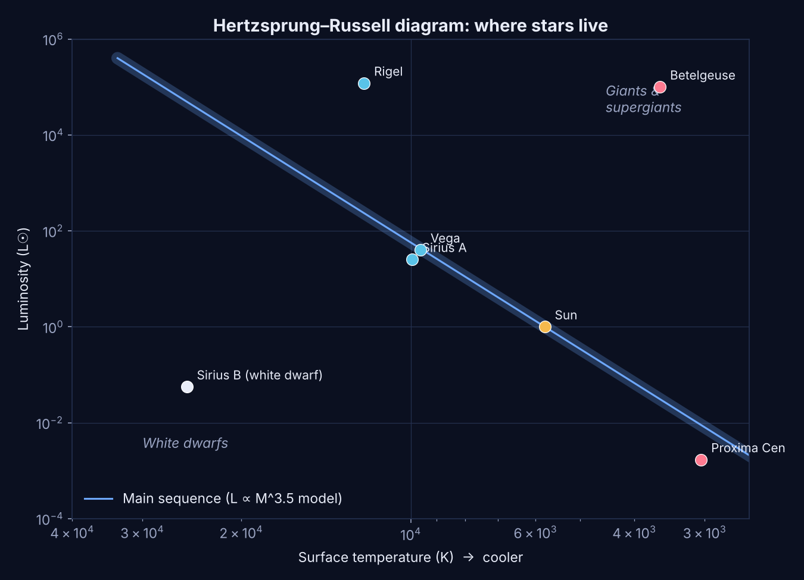
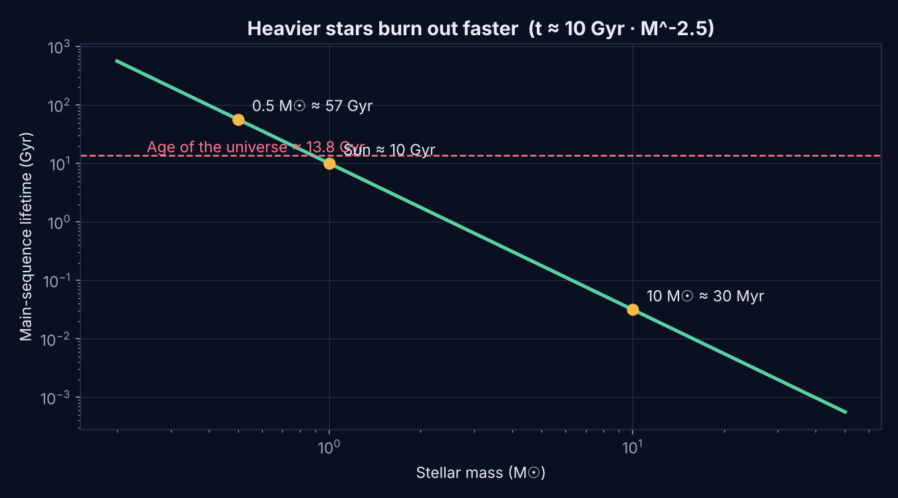

## Birth: from nebula to protostar

Stars form in cold molecular clouds. A disturbance, such as a nearby supernova shock or galactic collision, makes a dense clump collapse. It spins up and flattens into a disk around a hot protostar. When the core reaches ~10 million K, hydrogen fusion ignites and a star is born. Leftover disk material can form planets.

## Life: the main sequence

The **Hertzsprung–Russell diagram** plots brightness against temperature. Stars spend ~90% of their lives on the **main sequence**, fusing hydrogen.

| Mass (Suns) | Lifetime | Fate |
|---|---|---|
| 0.08–0.5 (red dwarf) | Trillions of years | Fades to a white dwarf (none has yet finished) |
| 0.5–8 (Sun-like) | ~10 billion years for the Sun | Red giant → planetary nebula → white dwarf |
| 8–25 | ~10–50 million years | Red supergiant → core-collapse supernova → neutron star |
| >25 | A few million years | Supernova or direct collapse → black hole |

## Death

- **Sun-like stars** swell into red giants, fuse helium into carbon and oxygen, shed their outer layers as a glowing [planetary nebula](/wiki/galaxies/ring-nebula-m57.html), and leave a [white dwarf](/wiki/objects/white-dwarf.html).
- **Massive stars** build an onion of shells (hydrogen, helium, carbon, neon, oxygen, silicon) around an iron core. Iron fusion absorbs energy, so the core collapses in under a second, triggering a [supernova](/wiki/objects/supernova-core-collapse.html) and leaving a [neutron star](/wiki/objects/neutron-star.html) or [black hole](/wiki/objects/black-hole.html).

## We are made of star stuff

Carbon in your cells, oxygen you breathe and calcium in your bones were forged in stars. Iron came from supernovae, and much of the gold and platinum on Earth from neutron-star mergers ([kilonovae](/wiki/objects/kilonova.html)).
