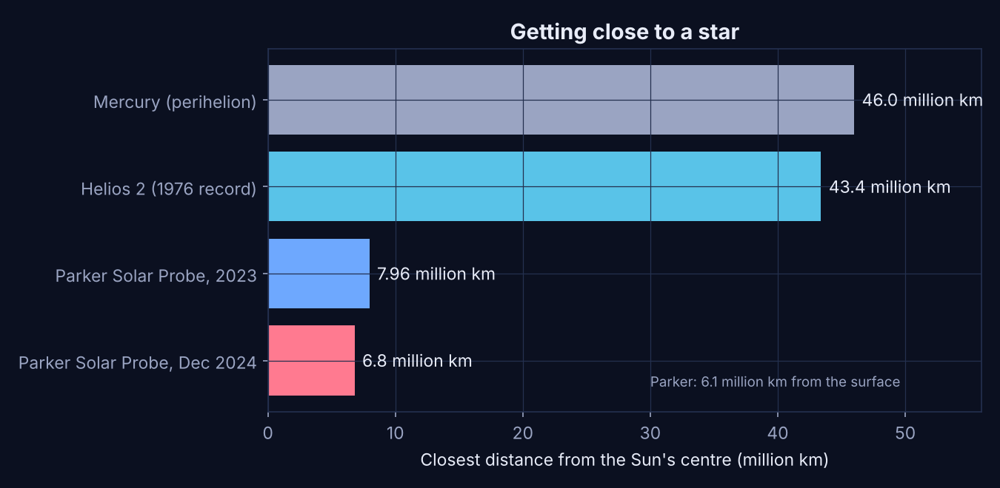

{{chart:solarcycle}}

## The Sun in numbers

A G2V yellow dwarf ~4.6 billion years old, 109 Earths wide, with a 15-million-K core and a 5,772 K surface, and a million-degree corona whose heating is still not fully understood.

## The solar cycle

Sunspots rise and fall over ~11 years as the magnetic field flips. **Solar Cycle 25 reached its maximum in October 2024** (smoothed sunspot number ~161), stronger than forecast.

## Space weather

- **Solar flares** emit X-rays that disrupt radio within minutes.
- **Coronal mass ejections** reach Earth in 1–3 days, triggering geomagnetic storms and auroras. In May 2024 the strongest storm in two decades produced auroras visible as far south as Ladakh in India.
- The **Carrington Event (1859)** set telegraph lines on fire; a similar storm today could damage power grids and satellites.

## Missions

- **Parker Solar Probe** passes ~6.1 million km from the Sun's surface at ~690,000 km/h, the fastest object ever built.
- **Solar Orbiter** (ESA–NASA) photographed the Sun's poles for the first time (2025).
- **Aditya-L1** (ISRO, 2023) watches the Sun continuously from the L1 point.

More: [Research: heliophysics](/wiki/research/sun-and-space-weather-now.html).
