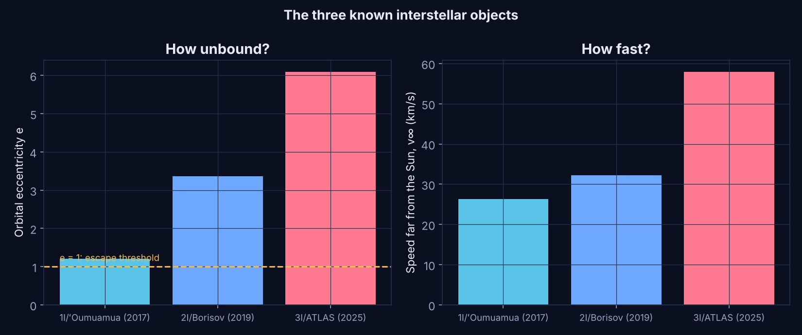
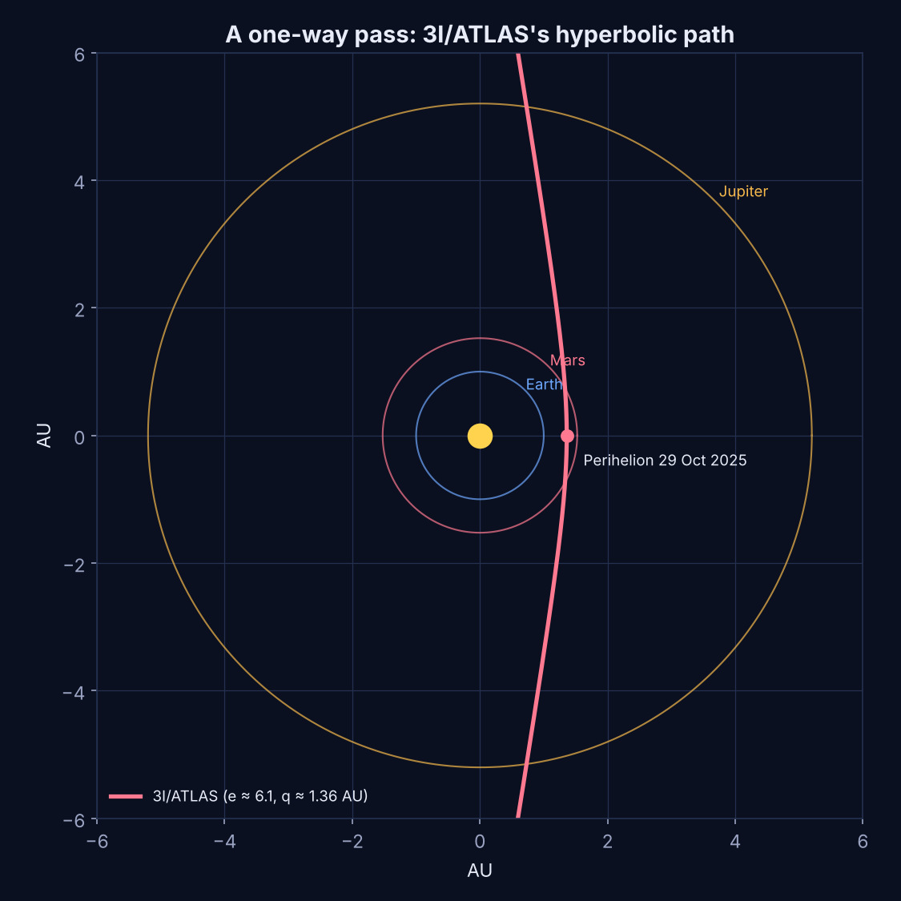

# ☄️ Small Bodies — comets, asteroids and interstellar visitors

The leftovers of planet formation, here and around other stars.

## Pattern Summary

- **3I/ATLAS** (discovered 1 July 2025) is only the third interstellar object ever found. It is by far the fastest (v∞ ≈ 58 km/s) and most unbound (e ≈ 6.1), and may be older than the Solar System.
- **Sample return** is how small-body science gets decisive. Tianwen-2 is at the quasi-moon Kamoʻoalewa now, after Hayabusa2 and OSIRIS-REx.
- **Rubin LSST** (survey started June 2026) is expected to find many more interstellar objects and millions of Solar System bodies.

## Gallery

## Notes

- [`interstellar-objects-and-asteroids.md`](./interstellar-objects-and-asteroids.md)
