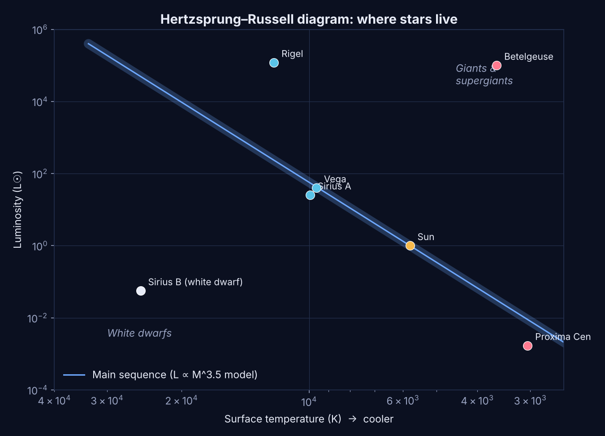
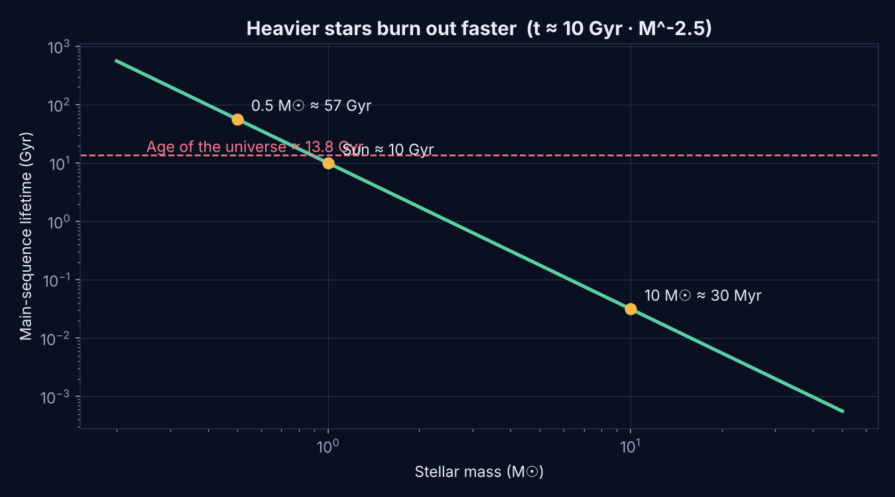
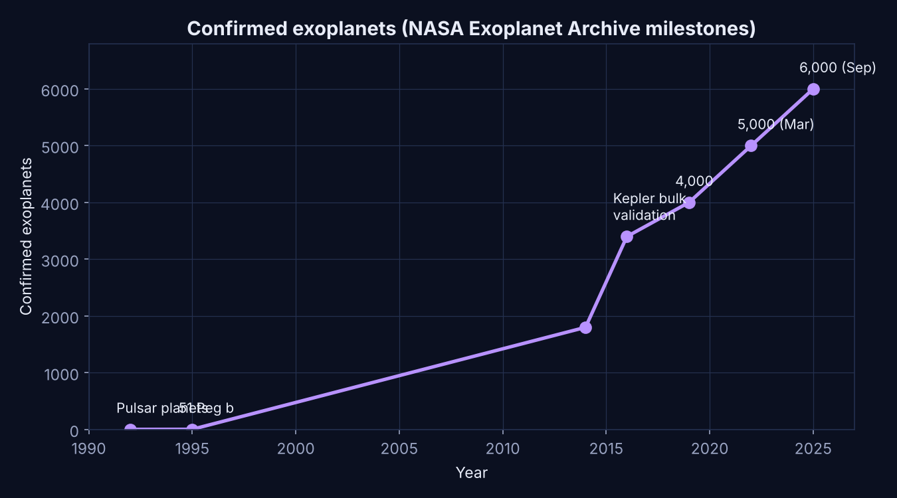

# ⭐ Stellar — stars and exoplanets

How stars are born, live and die, and what we have learned about the planets around them.

## Pattern Summary

- A star's **mass** sets almost everything: luminosity (L ∝ M^3.5 on the main sequence), colour, lifetime and how it dies.
- Massive stars live fast (millions of years) and die as supernovae; small red dwarfs can outlive the current age of the universe.
- More than **6,000 exoplanets** are now confirmed, most found by the transit method, and red-dwarf systems are the best places to study rocky, temperate worlds today.

## Gallery

## Notes

- [`stellar-evolution-and-exoplanets.md`](./stellar-evolution-and-exoplanets.md): concepts, open questions, dated studies and sources
